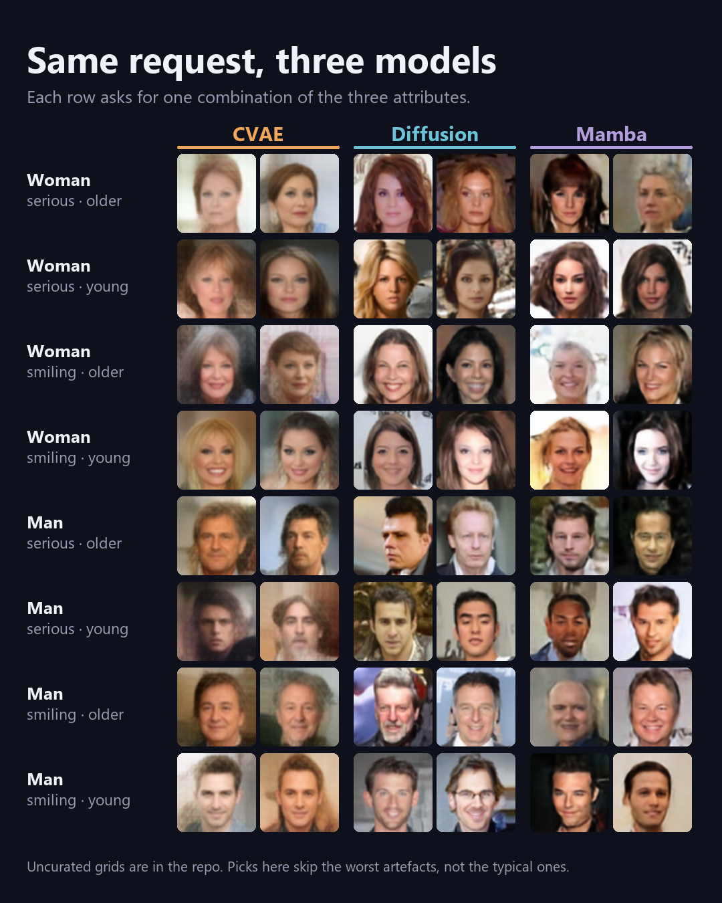
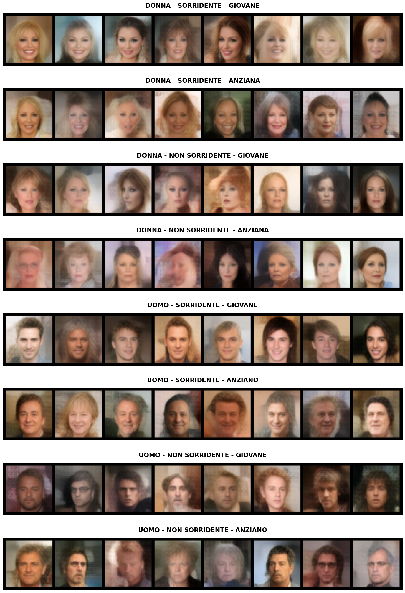
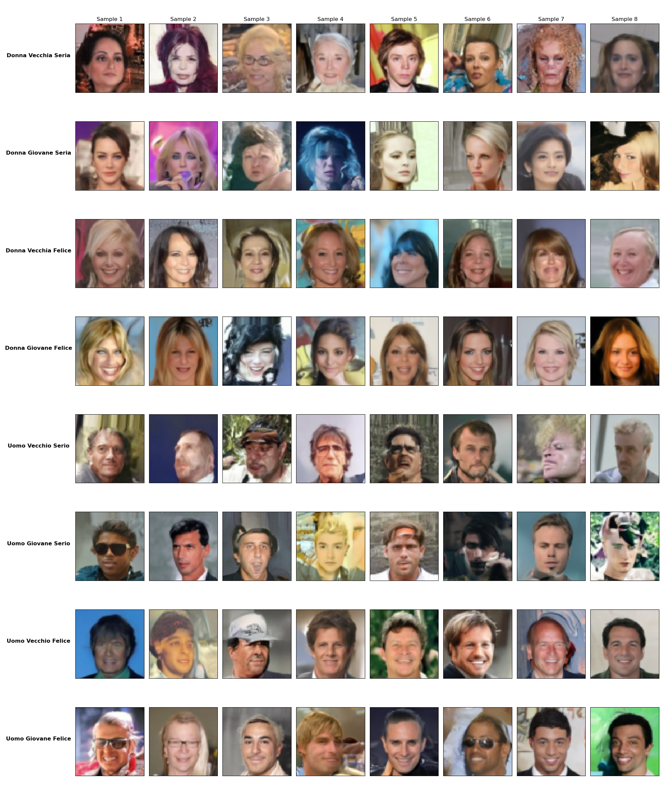
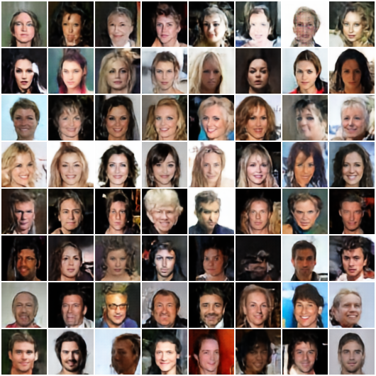

# Conditional Face Generation: CVAE vs Diffusion vs Mamba

Three conditional generative models that produce **64×64 faces** from three binary attributes of the
[CelebA](https://mmlab.ie.cuhk.edu.hk/projects/CelebA.html) dataset:

| Attribute | CelebA index | 0 | 1 |
|---|---|---|---|
| `Male` | #20 | woman | man |
| `Smiling` | #31 | serious | smiling |
| `Young` | #39 | older | young |

The brief asked for three models built on three *different* techniques. We picked a
**Conditional VAE**, a **Denoising Diffusion Model** and a **Mamba state-space model** generating VQ-VAE tokens.

Project for the *Generative AI* course (prof. Pasquale Foggia), MSc in Computer Engineering, University of Salerno, A.Y. 2025/26.

<p align="center">
  
</p>

---

## The three models

### 1. Conditional VAE (`src/cvae`)

A convolutional VAE where both the encoder and the decoder see the attributes.

- **Encoder**: the 3 attributes are broadcast as extra input channels (3 + 3 channels), followed by four strided
  convolutions (64 → 32 → 16 → 8 → 4) with residual blocks, giving `μ` and `log σ` for a 128-dim latent.
- **Decoder with deep conditioning**: the attribute vector is concatenated to the feature map again **before every
  upsampling stage**, so the condition is not "forgotten" deeper in the decoder.
- **Upsample + Conv instead of ConvTranspose** to avoid checkerboard artefacts.
- **Loss**: `BCE (sum) + β·KL + λ·VGG16 perceptual loss` (VGG features at `conv1_2`, `conv2_2`, `conv3_3`, `conv4_3`),
  β = 1, λ = 0.001. Adam, lr 2e-4 halved every 20 epochs, 80 epochs.
- **Sampling**: `z ~ N(0, T·I)` with a temperature `T`, concatenated to the attributes and decoded in one pass.

### 2. Conditional Diffusion Model (`src/diffusion`)

A DDPM-style model trained to predict the noise, sampled with DDIM.

- **Network**: U-Net with residual blocks and GroupNorm, channels 128 → 256 → 512 → 768, self-attention
  (4 heads) at 32×32, 16×16 and in the 8×8 bottleneck.
- **Conditioning**: sinusoidal timestep embedding and an MLP embedding of the attributes, merged by a small MLP into
  a single context vector injected in every block.
- **Noise schedule**: cosine schedule, L = 1000 steps.
- **Training**: MSE on the noise with **Min-SNR weighting** (clamped to [0.5, 2]), AdamW (lr 2e-4, wd 0.01),
  5-epoch linear warm-up then cosine decay, gradient clipping, **EMA** of the weights (decay 0.999), 100 epochs.
- **Classifier-free guidance**: the attributes are dropped 10% of the time during training; at sampling time
  `ε = ε_uncond + s·(ε_cond − ε_uncond)` with `s = 1.5`.
- **Sampling**: deterministic **DDIM with 50 steps** instead of 1000.

### 3. Mamba over VQ-VAE tokens (`src/mamba`)

A two-stage model: first learn a discrete vocabulary of image patches, then generate faces token by token.

- **Stage 1, VQ-VAE**: compresses a 64×64 image into a **16×16 grid of tokens** from a **1024-entry codebook**
  (256-dim). The codebook is updated with **EMA** and dead codes are restarted; reconstruction loss is
  `MSE + 2·L1 + Sobel edge loss + commitment`.
- **Stage 2, Mamba**: 16 residual Mamba layers (dim 512, state size 16, expansion 2, causal conv kernel 17)
  predict the next token with cross-entropy. The sequence is `[SOS, male, smiling, young, t₀ … t₂₅₅]`.
  - **Snake ordering**: tokens are read row by row, alternating direction, so neighbours in the sequence are
    always neighbours in the image.
  - **Learnable 2D positional embeddings** (row + column).
  - **Classifier-free guidance** with a dedicated "null" attribute token (10% dropout), `cfg_scale = 1.7` at inference.
  - The selective scan uses a parallel (Blelloch) scan in training and a cached recurrent state at inference,
    so each new token costs O(1).
- **Sampling**: temperature 0.8 and top-k 50, then snake → raster reordering and VQ-VAE decoding.

---

## Results

Uncurated samples, 8 per attribute combination:

| CVAE | Diffusion | Mamba |
|---|---|---|
|  |  |  |

Mamba grid rows, top to bottom: woman serious older, woman serious young, woman smiling older, woman smiling young,
and the same four for men.

What we observed:

- **CVAE** follows the attributes reliably and is by far the fastest, but the faces are smooth and blurry, typical
  of VAEs even with the perceptual loss.
- **Diffusion** gives the sharpest and most varied faces, including backgrounds and accessories. It is also the
  slowest to train and sample, and sometimes produces a broken face.
- **Mamba** sits in between: sharper than the CVAE thanks to the VQ-VAE decoder, but with blocky artefacts where
  a wrong token is sampled. Since the generation is autoregressive, one error early on affects everything that follows.

---

## Repository structure

```
├── config.py                 # shared paths (dataset, weights, output)
├── conda/                    # environment build / delete scripts
├── src/
│   ├── cvae/
│   │   ├── model/            # CelebACVAE, VGG perceptual loss
│   │   ├── train/train_cvae.py
│   │   └── generate/generate_cvae.py
│   ├── diffusion/
│   │   ├── model/            # U-Net, attention, time encoding, cosine schedule
│   │   ├── train/Train.py
│   │   └── generate/Test_Attribute.py
│   └── mamba/
│       ├── model/            # VQ-VAE, Mamba block/layer, parallel scan, MambaVQVAE
│       ├── train/vq_vae_train.py, train_mamba_vq.py
│       └── generate/generate.py
├── weights/                  # trained checkpoints (not tracked, see below)
└── output/                   # generated grids
```

## Getting started

### Environment

```bash
bash conda/build/build.sh        # or conda\build\build.bat on Windows
conda activate genai_project
pip install torch torchvision tensorboardX
```

Install the PyTorch build that matches your CUDA version from [pytorch.org](https://pytorch.org/get-started/locally/).
Generation also runs on CPU and on Apple Silicon (MPS).

### Weights

The checkpoints are too large for Git (~2.3 GB in total). Put them here:

```
weights/cvae/model.pth
weights/diffusion/checkpoint_ep100.pth
weights/mamba/vqvae_16x16_2_epoch_50.pth
weights/mamba/mamba_vqvae_snake_cfg_k17_epoch_100.pth
```

### Generate

Run from the repository root. Each script writes an 8-combination grid into `output/<model>/`.

```bash
python src/cvae/generate/generate_cvae.py
python src/diffusion/generate/Test_Attribute.py
python src/mamba/generate/generate.py
```

### Train

CelebA is loaded with `torchvision.datasets.CelebA` (`split='train'`, `target_type='attr'`). Images are center-cropped
to 178×178 and resized to 64×64.

```bash
python src/cvae/train/train_cvae.py          # dataset under ./dataset (see config.py)
python src/mamba/train/vq_vae_train.py       # stage 1
python src/mamba/train/train_mamba_vq.py     # stage 2, needs the VQ-VAE checkpoint
```

The diffusion model was trained on the university HPC cluster (SLURM). `src/diffusion/train/Train.py` reads the
dataset from the cluster path in `DATA_ROOT`; change it to your local copy before running. Training progress
(losses, sample grids, codebook perplexity) is logged to TensorBoard under `runs/`.

---

## Authors

- Francesco Monda
- Leonardo Luongo
